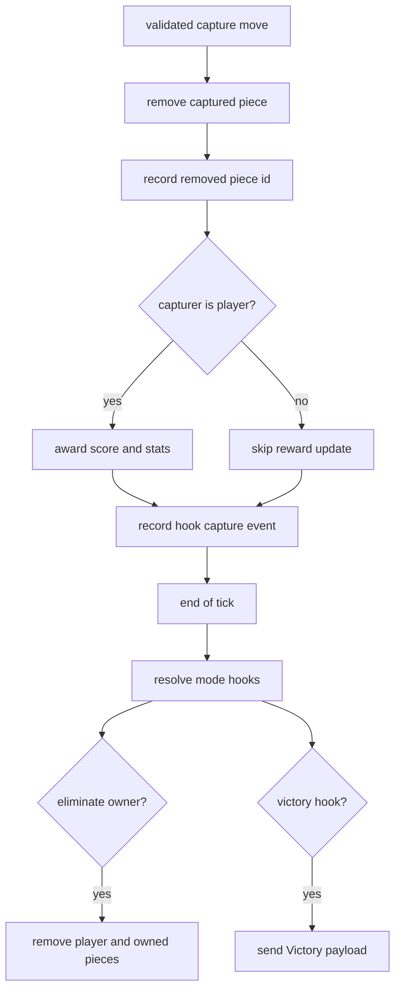

# Combat, Captures, And Hooks

Combat in `ffchess` is simple at the board layer and rich at the mode layer:

- the board layer removes pieces and awards score,
- the mode layer decides whether a capture also eliminates a player or ends the match.

## Capture Application

Captures are applied by the shared `Simulation` (`common/src/rules/simulation.rs`); the server
then handles their consequences in `server/src/instance/world.rs`.

On a successful capture:

1. The target piece is removed from `game.pieces`; the next `UpdateState` snapshot no longer contains it.
2. Any queued actions of the captured piece are cancelled.
3. If the capturer is a player:
   - `score` increases by the captured piece config's `score_value`,
   - `pieces_captured` increments,
   - `kills` increments when the captured piece id is treated as a king.
4. A hook event is recorded for end-of-tick resolution.

## King Semantics

There is no separate boolean "is king" flag in the piece config.

The runtime treats a piece as a king when its piece id:

- is exactly `king`, or
- ends with `_king`

That rule affects:

- kit validation,
- kill counting,
- common hook targeting patterns.

## Hook Buffering

Hook resolution is deliberately delayed until the end of the tick.

The server records events into `HookEvents` (`server/src/instance/hooks/events.rs`):

- capture and kill events,
- "a player left", join, and disconnect events,
- queue countdown and game start events.

All instance state sits behind one lock, so events recorded between ticks simply accumulate.
At the end of each tick, the collected events are resolved against the mode's configured hooks.

This keeps capture side effects deterministic even when several things happen inside one tick.

## Supported Hook Outcomes

### `OnCapture` + `EliminateOwner`

If the captured piece matches `target_piece_id`, remove that captured piece's owner from the game.
All of their remaining pieces are removed and their queued actions are cancelled. With
`set_camera`, the owner is first sent the camera move, centred on the captured piece's square.

### `OnCapturePieceActive` + `WinCapturer`

If the capture matches, send the capturing player a victory payload.

With `set_camera`, the capturing player is also sent the camera move, centred on the capture
square.

### `OnPlayerLeave` + `WinRemaining`

If a player left during the tick and the remaining player count matches `players_left`
(or `players_left` is omitted), send victory to the remaining player.

## Victory Delivery

The server sends `ServerMessage::Victory` with:

- `title`
- `message`

The client switches into its victory/dead phase.

## Death Camera

Hooks with `set_camera` send `ServerMessage::SetCamera` to the player they affect, carrying the
hook's camera expressions and the square the piece died on. The client evaluates them against its
own screen, since `max_fit_zoom` depends on it, and flies the camera there once per message. The
message may arrive before the snapshot that ends the player's life; the flight carries on through
the phase change. Without a camera move, the camera stays where it is when the life ends.

## Combat Diagram

