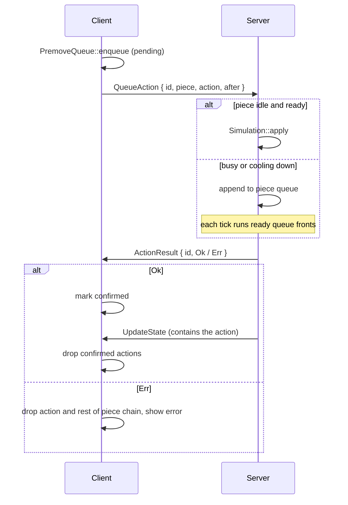

# Movement And Premoves

Movement is split across three layers:

1. shared rules in `common/src/rules/` (`movement.rs` validates paths and builds move plans,
   `special.rs` plans special moves, `simulation.rs` applies plans and purchases to a `GameState`),
2. authoritative execution in `server/src/instance/actions.rs`, which runs the shared simulation
   against the live board,
3. prediction in the client (`client/src/premoves.rs`), which runs the very same simulation
   against a copy of the latest snapshot.

Because both sides apply actions with the same code, what the client draws as a premove is exactly
what the server will do if the board does not change in the meantime.

## Shared Validation Rules

`Catalog::check_move()` answers one question: "Given the current board state, may this piece
move to that square, and is it a quiet move or a capture?"

Internally it builds a **move plan**: every change the move makes (captures, relocations, type
changes), worked out without touching the board. A rejected move therefore changes nothing, and
applying a plan needs no further checks. Path moves are tried first; when no path reaches the
target, each of the piece's `special_moves` is tried (see
[Special Moves](../config/pieces.md#special-moves)). When neither applies, the path error is
returned. The chosen plan must finally meet the piece's
[destination requirements](../config/pieces.md#destination-requirements), checked on a copy of
the board with the plan applied (`DestinationRestricted` otherwise); this is how kings are kept
out of check.

Path moves enforce:

- start and end squares must differ,
- the target must be inside the current board bounds (`InvalidMove`),
- a target held by the same owner is rejected (`TargetFriendly`; NPCs never capture NPCs),
- quiet moves use `move_paths`, captures use `capture_paths`,
- the target displacement must match a step of one of those paths (`InvalidMove`),
- every earlier step of a matching path must be empty (`PathBlocked` when all are blocked).

`Catalog::legal_moves()` lists every legal move, special moves included; the renderer uses it
for move hints, taps use it to pick the move, and NPCs use it to pick moves. Each `LegalMove`
holds the mover's target, its kind (a special move that captures counts as a capture), and the
**affected** squares: where the other pieces it captures, relocates, or changes stand. A move
with affected squares is hinted with a capture frame on them and chosen by tapping them; any
other move is hinted with a dot on its target and chosen by tapping that. A normal capture's
affected square is its target, so captures look as they always did, while castling frames the
rook. Either way the client sends the mover's target with the move.

`Catalog::threats()` builds a `ThreatMap` of which pieces could capture which, walking each
capture path once up to its first piece. The client resolves
[shading rules](../config/pieces.md#shading) against it with `Catalog::shading()` whenever the
board changes, and draws the resulting backgrounds below the pieces and threat marks above them.

`Catalog::is_targeted()` tells whether a piece of another owner could capture onto a square
along its `capture_paths` with a clear path. Special move conditions use it for the
`*_targeted` variables. These checks live on `Catalog` rather than `PieceConfig` because
targeting needs the configs of every piece on the board.

The validator does not understand turns, cooldowns, matchmaking, or victory. Cooldowns are
checked by the server's action queue.

## Actions

Players never move pieces directly. Every request is a `PieceAction` on one piece:

- `Move { target }`: move or capture,
- `Buy { item }`: buy item `item` from the shop the piece stands on.

The client sends each action as `ClientMessage::QueueAction(ActionRequest)` the moment the player
issues it:

| Field | Meaning |
| --- | --- |
| `id` | Client-chosen `ActionId`, unique per connection. |
| `piece_id` | The piece acting. |
| `action` | The `PieceAction`. |
| `after` | The previous unresolved action of the same piece, if any. |

The server answers every request with exactly one `ServerMessage::ActionResult { id, result }`.

## Server Action Queue

The server keeps one queue of actions per piece.

- A new action runs immediately when its piece has nothing queued and the action is ready;
  otherwise it is appended to the piece's queue (at most 100 per piece).
- A `Buy` is always ready. A `Move` is ready once the match countdown is over and the piece's
  cooldown has elapsed (`now - last_move_time >= cooldown_ms`).
- Every tick runs the ready actions at the front of each queue, in order. Several purchases or a
  move followed by a purchase can resolve in the same tick.
- If an action fails when it runs, its result is the error and the rest of that piece's queue is
  cancelled with `ActionCancelled`.
- A request whose `after` names an action that failed or was cancelled is cancelled immediately.
  This covers requests that were already on the wire when the failure happened: the client
  planned them from a square the piece never reached.
- `ClientMessage::ClearActions { piece_id }` cancels the piece's queue.
- When a piece leaves the board (captured, its owner eliminated or gone, pruned by a shrinking
  board), its queue is cancelled.

Every instance keeps its state behind one lock and sends messages while holding it, so an
`ActionResult` always arrives before the first `UpdateState` snapshot that reflects the action.

## Applying A Move

`Simulation::apply_move()`:

1. plans the move (see above),
2. removes every captured piece and credits the mover's owner
   (`score += score_value`, `pieces_captured += 1`, `kills += 1` for kings); taking your own
   piece through a special move earns nothing,
3. relocates every moved piece and counts the move in `moves_made`; only the mover stamps
   `last_move_time` and takes `cooldown_ms` from its type, so partners stay as ready as they were,
4. applies type changes (`becomes`), adopting the new type's cooldown,
5. if the mover belongs to a player and landed on an auto-upgrade shop, buys that shop's single
   offer (see below). An upgrade that cannot be afforded or placed simply does not happen.

The returned `ActionEffects` list the captured pieces, every relocation, and the **partners**:
pieces other than the mover that the action changed. The server records hook events for the
captures, cancels the queued actions of every partner (they were planned from where the partner
stood before), and respawns any shop whose last use was consumed.

## Applying A Purchase

`Simulation::apply_purchase()` resolves the shop under the piece, the item group for the piece's
type, and the item. All checks (price, free squares for added pieces) happen before anything
changes, so a failed purchase leaves the board untouched. A successful purchase:

- deducts the price from the owner's score,
- replaces the piece type (and its cooldown) when `replace_with` is set,
- places `add_pieces` on the first free neighbouring squares,
- uses up one charge of the shop, removing it at zero.

## Auto-Upgrade Shops

If a player piece lands on a shop where:

- `auto_upgrade_single_item == true`, and
- exactly one item applies to that piece,

that item is bought automatically as part of the move. Pawn advancement in the queue modes uses
this mechanic instead of hard-coding pawn state transitions in move logic. Because prediction runs
the same simulation, a premoved double step onto the step-shop row correctly turns the predicted
pawn into its single-step variant for the following premoves.

## Client Prediction

`PremoveQueue` (in the reducer) holds the local player's unresolved actions:

1. Queueing an action records it as pending and sends it (inside the reducer, so ids and `after`
   always come from the latest queue).
2. `ActionResult` with `Ok` marks the action confirmed; it is dropped when the next snapshot
   arrives, since that snapshot already contains it.
3. `ActionResult` with an error drops the action and every later action of the same piece.
   The client only sends actions that are valid on its predicted board, so errors caused by the
   board changing underneath a premove (`PieceNotFound`, `TargetFriendly`, `InvalidMove`,
   `PathBlocked`, `ShopNotFound`) and `ActionCancelled` are dropped quietly; other errors
   (for example `InsufficientScore`) are shown as a toast.
4. Every snapshot also drops actions of pieces that no longer exist.

For drawing, `PremoveQueue::project()` applies all unresolved actions, in order, to a copy of the
snapshot. Every relocation of a successful move becomes a premove line, so a castle draws one line
for the king and one for the rook; the projected board provides the faded "ghost"
pieces, the selection, move hints, and which shop menu to show. An action that fails in the
projection hides itself and the rest of its piece's chain, because the server will cancel them too.

Tapping one of your own pieces on its real square while it has queued actions clears them.
Otherwise, with a piece selected, a tap on a square that selects one of the selected piece's
legal moves (its target, or a piece it affects) queues that move, even on one of your own pieces
(the rook when castling). Tapping one of your pieces selects it when nothing is selected or it
selects none of the selected piece's moves.

## Movement Diagram

